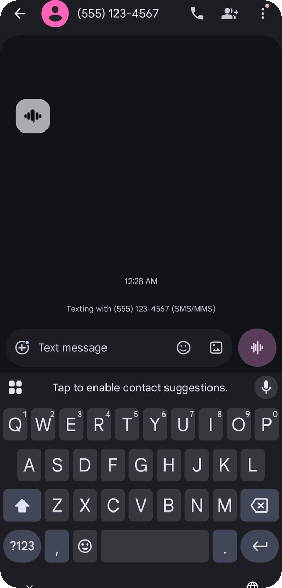
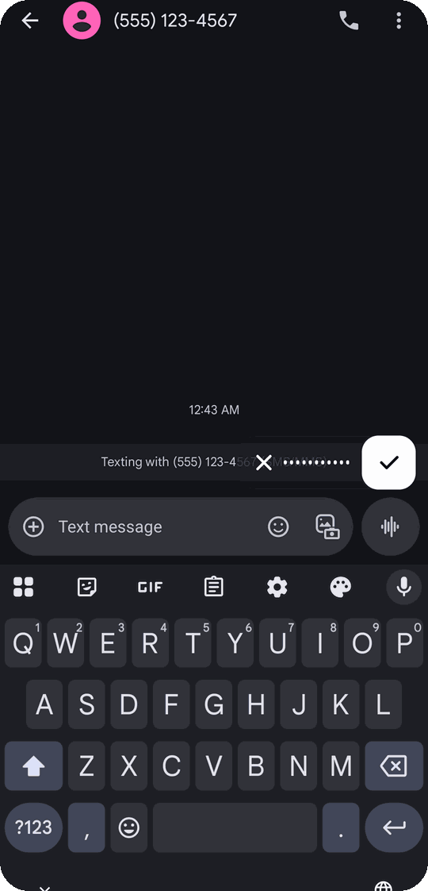
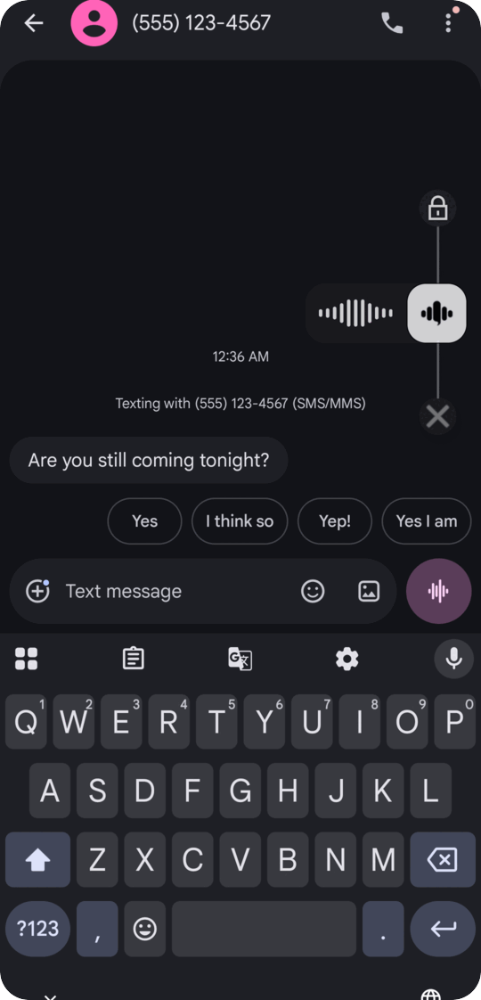
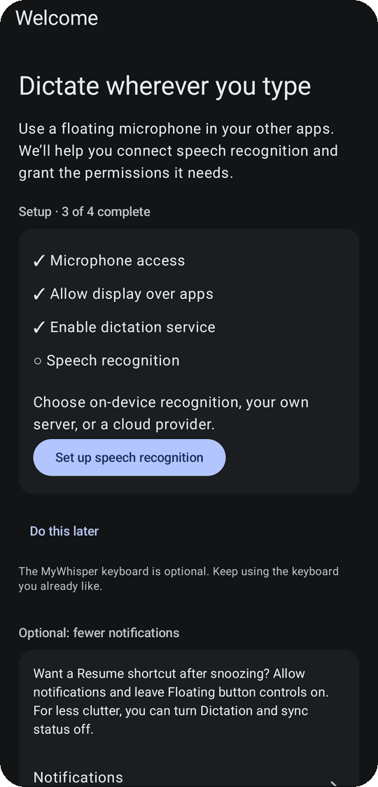
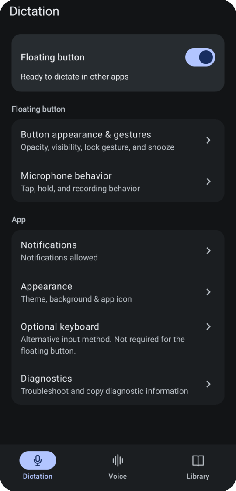
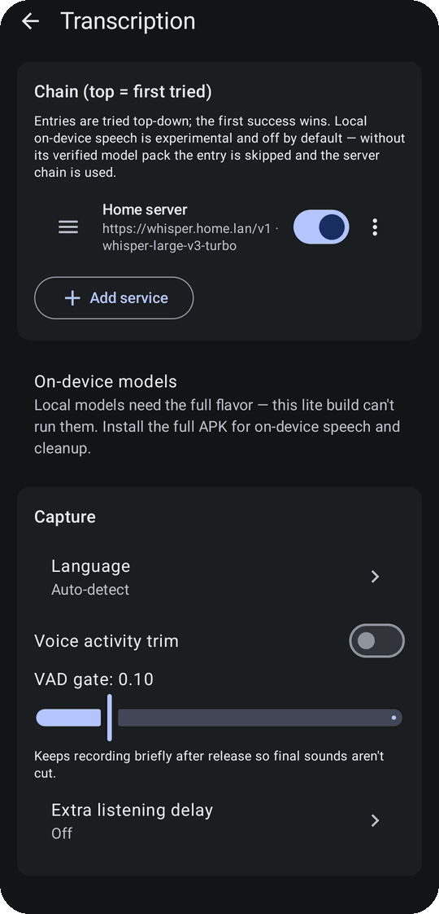
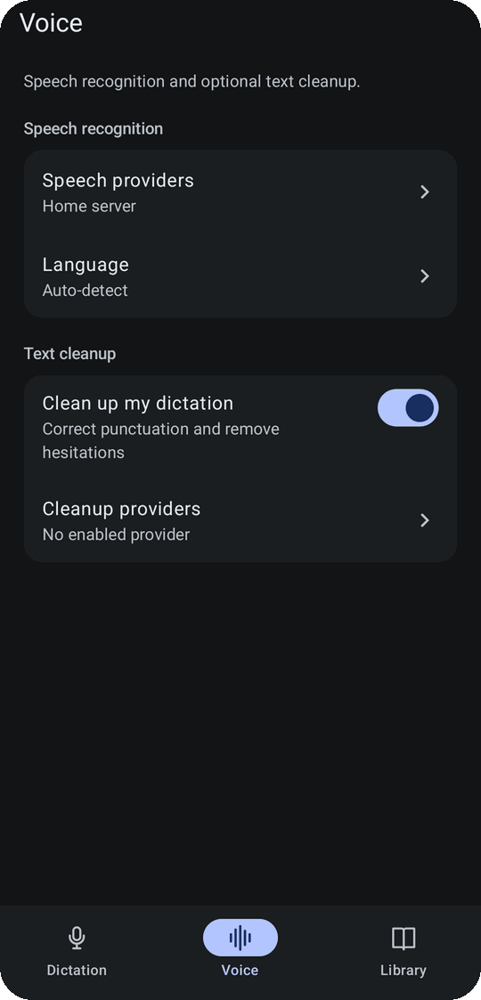
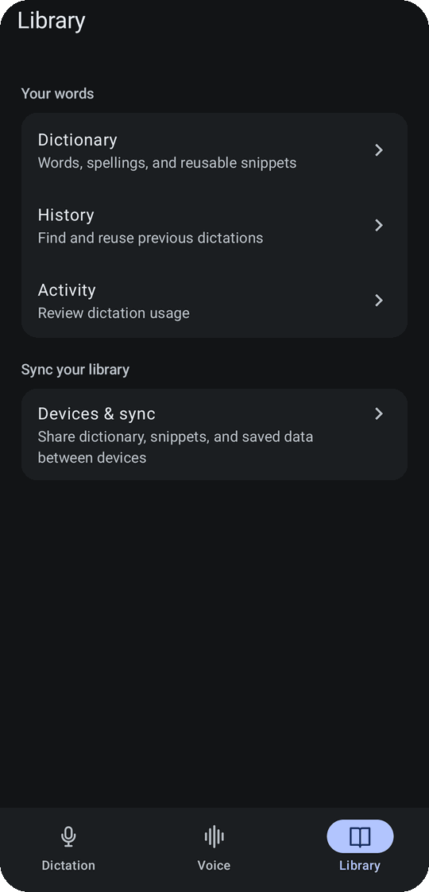

<div align="center">
  
  <h1>MyWhisperMobile</h1>
  <p>Voice typing for Android, powered by the MyWhisper engine.</p>
</div>

Dictate into other apps using a floating microphone button or the
MyWhisper input method. Configure speech recognition, text cleanup, and
other settings from the app.

## Install

Download the APK from [GitHub Releases](https://github.com/aaronroquefonseca/MyWhisperMobile/releases),
or get it with automatic updates from my F-Droid repository:
[**add it here**](https://f-droid.aaronroque.biz), then install MyWhisper
from F-Droid.

## Floating button

Focus any text field and the floating button appears over the app. A quick
tap starts dictation; tap ✓ to transcribe and insert the text, or ✕ to
discard it. Or press and hold to talk, release to send, slide up to lock
recording, or slide down to cancel. It follows the keyboard, snaps to the
screen edge, and can be dragged, faded, locked, or snoozed.

<table>
  <tr>
    <td align="center" width="33%">
      <br />
      <sub><b>Ready</b><br />rests above the keyboard</sub>
    </td>
    <td align="center" width="33%">
      <br />
      <sub><b>Tap to dictate</b><br />✓ inserts · ✕ cancels</sub>
    </td>
    <td align="center" width="33%">
      <br />
      <sub><b>Hold to talk</b><br />release sends · ↑ lock · ↓ cancel</sub>
    </td>
  </tr>
</table>

## Screenshots

<table>
  <tr>
    <td align="center" width="33%">
      <br />
      <sub><b>Guided setup</b></sub>
    </td>
    <td align="center" width="33%">
      <br />
      <sub><b>Dictation</b></sub>
    </td>
    <td align="center" width="33%">
      <br />
      <sub><b>Speech providers</b></sub>
    </td>
  </tr>
  <tr>
    <td align="center">
      <br />
      <sub><b>Voice</b></sub>
    </td>
    <td align="center">
      <br />
      <sub><b>Library</b></sub>
    </td>
    <td></td>
  </tr>
</table>

## Dictation at a glance

- **Floating button** — keep a microphone available over other apps and
  dictate into a focused text field. Setup guides you through microphone,
  display-over-apps, and dictation-service permissions.
- **MyWhisper keyboard** — an alternative input method with a mic bar.
  Hold and release to stop, or tap to start and tap again to finish.
- **Listening indicator** — an optional floating level meter shows audio
  activity while recording.
- **Your setup** — manage speech providers, text cleanup, dictionary,
  history, preferences, and sync from the app.

## Speech recognition

The supported default is server-based speech recognition, including
self-hosted OpenAI-compatible HTTP and sherpa-protocol WebSocket servers,
and cloud providers. On-device speech recognition and text cleanup are
experimental and off by default; they require verified model files. See
[core/README.md](core/README.md) for engine details.

## Layout

- `core/` — Rust engine (`mywhisper-core`), JNI `cdylib`.
  Verbatim desktop ports (`settings`, `audio`, `textnorm`, `store`)
  plus mobile-only `server_stt`, `engine`, JNI in `lib.rs`.
- `android/` — Kotlin app (Compose config + IME service).
- `scripts/build-core.sh` — `cargo ndk` release build for
  `arm64-v8a` + `x86_64` into `jniLibs` (runs automatically via the
  `buildRustCore` Gradle task).

## Build

Prerequisites: Android SDK (platform 36, NDK 28.x, CMake 3.22),
Rust targets `aarch64-linux-android` + `x86_64-linux-android`,
`cargo-ndk`, JDK 17.

```bash
cd android
./gradlew assembleDebug
adb install -r app/build/outputs/apk/debug/app-debug.apk
```

Then open the app and follow setup to configure speech recognition and
enable the floating button. To use the keyboard instead, enable and switch
to the MyWhisper input method and grant microphone access.

## F-Droid listing

The F-Droid store text, icon and screenshots live in
[`fastlane/metadata/android/en-US`](fastlane/metadata/android/en-US):
edit `title.txt`, `short_description.txt` and `full_description.txt`, and
pick screenshots by adding or removing symlinks in `images/phoneScreenshots`
(shown in file-name order). Merging to `main` publishes the listing; each
release adds its CHANGELOG section as the "What's new" text.

## Bringing desktop updates over

See `core/README.md`. Rule of thumb: `settings.rs`, `audio.rs`,
`textnorm.rs`, `store.rs` are byte-ports — re-copy the desktop file,
re-apply the marked `ANDROID PORT` patches, run `cargo test`.
